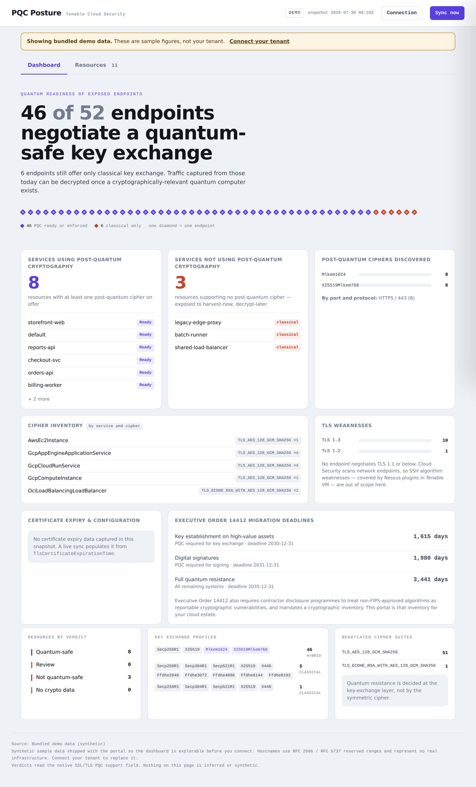
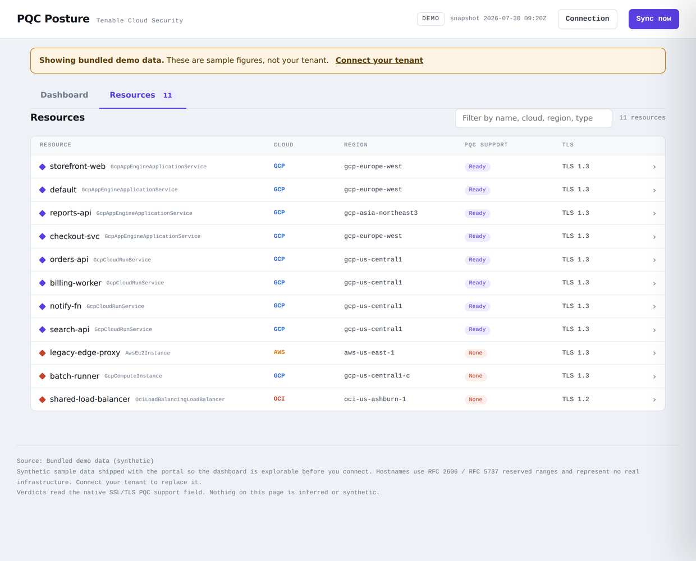
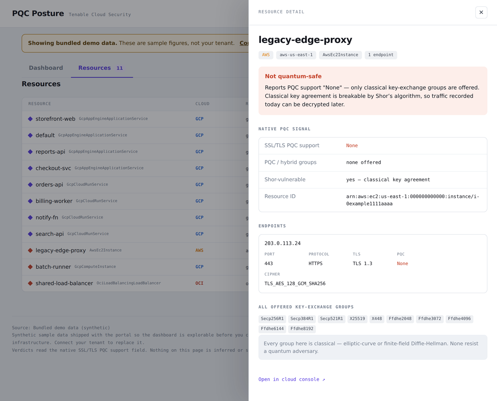
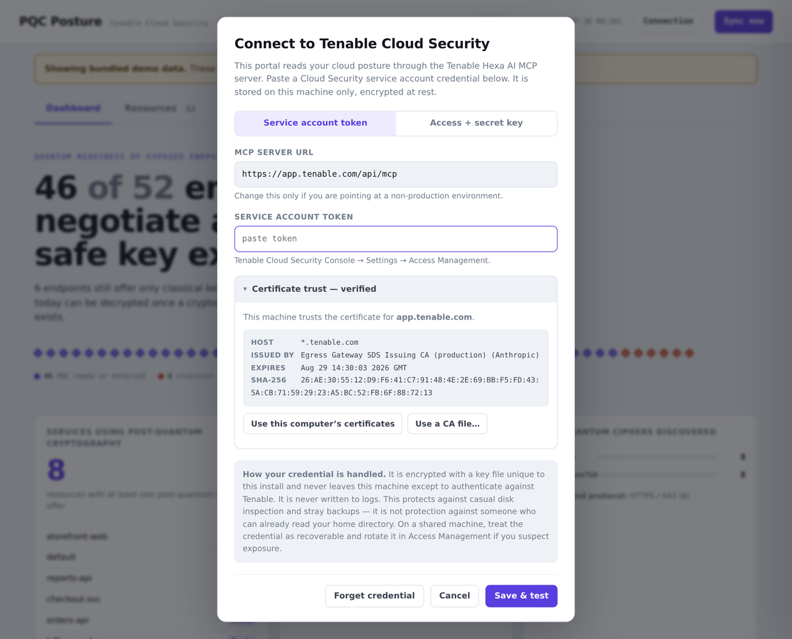

# PQC Posture Portal

A self-hosted web portal that shows **post-quantum cryptography readiness** for every internet-reachable resource in your cloud estate, using Tenable Cloud Security's native SSL/TLS PQC telemetry.

Zero dependencies. No pip install, no Node, no build step, no external network calls — Python standard library and one HTML file.

```bash
python3 app.py
```

Then open <http://localhost:8787>. On first run the portal opens a **Connection**
dialog: paste a Cloud Security service account token, click **Save & test**, and it
syncs your tenant. Until you do, it serves a small bundled demo snapshot that is
clearly labelled as such.

## Screenshots

The dashboard opens first: readiness ratio, one diamond per endpoint, and the widget
grid.



The resource inventory is filterable by name, cloud, region and verdict.



Clicking any resource opens the cryptographic drill-down. Here a classical-only host —
every offered key-exchange group is an elliptic curve or FFDHE, none post-quantum, which
is exactly why it scores Not quantum-safe.



On first run you paste a service account token. Certificate trust is resolved from your
OS store automatically; the panel is there for when it needs a hand.



> Screenshots show the bundled synthetic demo data. Hostnames and addresses use RFC 2606
> and RFC 5737 reserved ranges and represent no real infrastructure.

## Why this exists

Every TLS endpoint you expose today negotiates a key exchange. If that key exchange is classical — ECDHE, DHE, RSA — it is breakable by Shor's algorithm on a sufficiently capable quantum computer. That matters *now*, not later: an adversary can record encrypted traffic today and decrypt it once such a machine exists. This is the **harvest-now, decrypt-later** problem, and it is the reason NIST standardised ML-KEM and regulators have begun asking for migration plans.

Tenable Cloud Security detects, per endpoint, whether a hybrid or post-quantum key exchange is on offer. This portal turns that signal into an answer to a question a security team can act on: *which of our exposed resources would survive a quantum adversary, and which would not?*

## What it does

- **Scores every resource** against the native `SSL/TLS PQC Support` field — `Enforced`, `Ready`, or `None` — rather than inferring posture from cipher names
- **Opens on a dashboard** modelled on Tenable Vulnerability Management's *Post-Quantum
  Cipher Analysis* dashboard, rebuilt on cloud data: services using PQC, services not
  using PQC, which post-quantum ciphers were discovered (by port and protocol), cipher
  inventory by service, TLS weaknesses, certificate expiry, and a live countdown to the
  Executive Order 14412 migration deadlines
- **Lists every resource** on a second tab: a filterable, searchable inventory with
  cloud, region, PQC support and TLS version
- **Drills into any resource** — click a row for a slide-over panel with the verdict and why, per-endpoint host/port/TLS/cipher, the complete set of offered key-exchange groups with post-quantum ones highlighted, and a deep link to the cloud console
- **Talks to nothing but Tenable** — no telemetry, no font CDN, no analytics. The
  only outbound request is the authenticated query to your own MCP endpoint. Pass
  `--snapshot` style offline use by simply never connecting: the bundled demo works
  with networking disabled

## The two pages

**Dashboard** (opens first) answers *how ready are we?* It leads with the endpoint
lattice — one diamond per scanned endpoint, coloured by PQC status — then seven widgets
mapped to the capabilities of Tenable's Cryptographic Inventory dashboard:

| Widget | Source |
| --- | --- |
| Services using post-quantum cryptography | resources with any PQC/hybrid KEX group |
| Services not using post-quantum cryptography | resources offering classical groups only |
| Post-quantum ciphers discovered | PQC group tally, broken out by port and protocol |
| Cipher inventory | negotiated cipher per service type |
| TLS weaknesses | protocol distribution, flagging TLS 1.1 and below |
| Certificate expiry & configuration | `TlsCertificateExpirationTime` bucketed by urgency |
| EO 14412 deadlines | days remaining to 2030-12-31, 2031-12-31 and 2035 |

Where Cloud Security has no equivalent signal, the widget says so instead of inventing
one. SSH algorithm weaknesses and Nessus plugin severities are out of scope because
Cloud Security scans network endpoints, not hosts; Asset Criticality Rating is a
Tenable VM concept with no Cloud Security counterpart. Clicking a verdict jumps to the
inventory with that filter applied.

**Resources** is the inventory and the drill-down.

## Verdicts

| Verdict | Meaning |
| --- | --- |
| **Quantum-safe** | PQC enforced, or ready on every endpoint, on a modern protocol. Hybrid or post-quantum key agreement is available. |
| **Review** | Partial PQC coverage across endpoints, or a legacy protocol (TLS 1.1 or below) is still enabled. |
| **Not quantum-safe** | Classical key exchange only. Exposed to harvest-now, decrypt-later. |
| **No crypto data** | Resource is exposed but has no PQC telemetry yet. Posture unknown until scanned. |

A key-exchange group counts as post-quantum if it is one of `Mlkem512/768/1024`, `X25519Mlkem768`, `Secp256R1Mlkem512/768`, `Secp384R1Mlkem1024`, `Mlkem512X25519`, `CurveSm2Mlkem768`, or the draft Kyber hybrids `X25519Kyber768Draft00` / `Secp256R1Kyber768Draft00`. Everything else — elliptic-curve, Brainpool, GOST, FFDHE — is classical.

## How it works

`app.py` runs a `ThreadingHTTPServer` from the standard library. It serves two things: the single-page UI at `/`, and the current snapshot as JSON at `/api/snapshot.json`. The frontend is one `web/index.html` with vanilla JavaScript — no framework, no bundler.

Verdicts are **recomputed server-side on every request** from the raw endpoint fields, so a stale or hand-edited `verdict` in the snapshot can never mislead the UI.

```
app.py                 server, credential vault, sync orchestration
datasource.py          MCP JSON-RPC client + verdict scoring (swap transport here)
trust.py               OS trust store resolution, TLS diagnostics, pinning
queries/fleet.json     saved UDM query: resources + endpoints + PQC fields
queries/fleet_legacy.json   fallback for tenants without the PQC fields
queries/aggregates.json     saved UDM queries for the summary widgets
web/index.html         single-page dashboard, table, and drill-down
data/snapshot.json     bundled demo snapshot (served until you connect)
```

## Connecting to your tenant

The portal queries Tenable Cloud Security directly through the **Tenable Hexa AI MCP
server** — it speaks MCP JSON-RPC over HTTPS itself, so no AI client is needed at
runtime and no model sits in the data path.

1. In the Tenable Cloud Security Console, go to **Settings → Access Management** and
   create or copy a **service account token**.
2. Open the portal, click **Connection**, paste the token, and hit **Save & test**.
3. Click **Sync now** whenever you want fresh data.

Access-key/secret-key pairs are supported as an alternative (`X-ApiKeys`), selectable
in the same dialog. A non-production MCP URL can be set there too.

### How your credential is handled

- Entered in the browser, posted once to the local server, then **encrypted at rest**
  with a per-install key file (`~/.pqc-portal/instance.key`, mode `0600`) using a
  PBKDF2-derived HMAC-SHA256 keystream.
- Never written to logs, never echoed in an API response, cleared from the DOM as
  soon as the dialog closes.
- The server binds `127.0.0.1` and rejects requests with a non-local `Host` header,
  which blocks DNS-rebinding attacks from a browser tab.

**Honest scope:** this defeats casual disk inspection and stray backups. It is *not*
protection against someone who can already read your home directory — the key file
lives there too. On a shared machine treat the token as recoverable, and rotate it in
Access Management if you suspect exposure. **Forget credential** in the dialog wipes
both the credential and the cached data.

### Schema drift is handled explicitly

The native PQC fields require a Cloud Security build that exposes them. On connect the
portal calls `udm_get_object_type_metadata` and checks. If `TlsPqcStatus` is absent it
falls back to `queries/fleet_legacy.json`, **labels the dashboard as inferred**, and
suppresses the widgets that would otherwise render misleading zeros. A saved view must
never turn a missing field into a clean bill of health.

### The queries are data, not code

Every query lives in `queries/*.json` as a plain UDM body. Nothing is hard-coded in
Python, so you can edit a filter, add a field, or write your own view without touching
the app — and the same document renders identically whether it came from a live sync or
a file. Swapping transports is confined to `datasource.py`.

## Windows

Nothing extra to install beyond Python itself, and **certificate trust works without
any manual step** — the portal reads the Windows `ROOT` and `CA` certificate stores
through the standard library, so a corporate TLS-inspecting proxy is handled the same
way your browser handles it.

```
python app.py
```

Use `python` (or `py app.py`), not `python3`. If Python is missing, install it from
python.org and tick **Add python.exe to PATH** during setup; the Microsoft Store build
works too.

Notes specific to Windows:

- Credentials live in `%USERPROFILE%\.pqc-portal`. POSIX file modes are ignored on
  NTFS, so the portal calls `icacls` to remove ACL inheritance and grant access to your
  account only. If `icacls` is unavailable the file falls back to the profile
  directory's inherited ACL — readable by local administrators.
- `openssl` is usually not on PATH. The Certificate trust panel still shows the
  fingerprint (computed in pure Python) but the issuer and subject lines may be blank,
  since those are parsed with `openssl` when Python leaves them empty.
- Binding to `127.0.0.1` should not trigger a Windows Defender Firewall prompt. If one
  appears, you can decline it — the portal does not need inbound network access.
- Stop the server with `Ctrl-C` in the same terminal.

## TLS and corporate certificates

**This is handled automatically.** Python is normally the only thing on a workstation
that ignores the OS certificate store — it ships its own bundle — which is why a
corporate TLS-inspecting proxy (Zscaler, Netskope, Palo Alto, an internal gateway) or a
tenant behind a private CA can verify fine in Chrome and fail in Python. Node solved
this with `NODE_USE_SYSTEM_CA`; this portal does the equivalent.

Trust is resolved in this order, first hit wins:

| # | Strategy | Notes |
| --- | --- | --- |
| 1 | Explicit CA bundle | `--ca-bundle`, `SSL_CERT_FILE`, or set in the UI |
| 2 | Pinned certificate | exact SHA-256, confirmed by the operator |
| 3 | `truststore` package | used automatically if present; not required |
| 4 | **OS trust store** | macOS keychains via `security`, Windows stores via `ssl.enum_certificates` — **this is what fixes most corporate machines** |
| 5 | Python default bundle | clean networks with public CAs |
| 6 | Verification disabled | only with `--insecure`, and it warns |

Step 4 is the one that matters for distribution. On macOS it exports
`SystemRootCertificates`, `System.keychain` (where MDM-installed corporate roots land)
and the login keychain. On Windows it reads the `ROOT` and `CA` stores from the standard
library. On Linux it points at the distro bundle. The result is cached in the data
directory and refreshed daily, because corporate roots do get rotated.

### If it still fails

Open **Connection → Certificate trust** in the portal. It tells you what is actually
signing the connection — issuer, subject, expiry, SHA-256 fingerprint — and offers:

- **Use this computer's certificates** — regenerate from the OS store and retry
- **Trust this certificate** — pin that exact certificate after you confirm the
  fingerprint out of band. Same trust model as accepting an SSH host key, and it fails
  closed if the certificate later changes. For private CAs you cannot export.
- **Use a CA file…** — point at a PEM your IT team supplied

No CLI flag, no README hunting, and nothing to explain to a customer over email.

### For support conversations

To identify what is signing a connection from a terminal:

```bash
openssl s_client -showcerts -connect YOUR_HOST:443 -servername YOUR_HOST \
  </dev/null 2>/dev/null | openssl x509 -noout -issuer
```

An issuer naming a security vendor or the customer's own company confirms TLS
inspection. `--insecure` exists to confirm that trust is the only problem; it prints a
warning because the service account token would travel over an unauthenticated
connection. Fix it properly with one of the three options above.

## Options

```
python3 app.py --port 9000        # different port
python3 app.py --host 0.0.0.0     # bind all interfaces (see below)
python3 app.py --no-browser       # don't auto-open a browser
python3 app.py --verbose          # log every request
```

Binds `127.0.0.1` by default. The portal has **no authentication**, so only bind a routable interface on a network you trust.

## Requirements

Python 3.8 or later. Nothing else.

## License

MIT — see [LICENSE](LICENSE).
